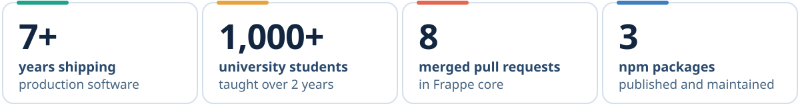
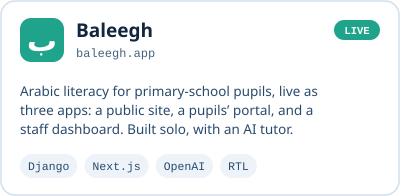
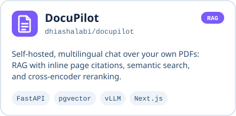
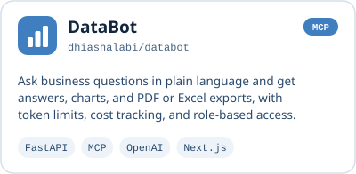
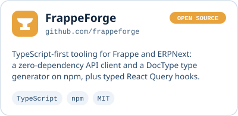

<picture>
  <source media="(prefers-color-scheme: dark)" srcset="assets/hero-dark.svg">
  
</picture>

  <a href="https://linkedin.com/in/dhiashalabi">LinkedIn</a>
  &nbsp;·&nbsp;
  <a href="mailto:dhia.shalabi@gmail.com">Email</a>
  &nbsp;·&nbsp;
  <a href="https://baleegh.app">Baleegh</a>
  &nbsp;·&nbsp;
  <a href="https://github.com/dhiashalabi/docupilot">DocuPilot</a>

For 7+ years I've designed and shipped backend systems that have to work in production: API platforms, job infrastructure, and AI features with real cost, latency, and permission constraints. I build in English and Arabic, and I've taught more than 1,000 university students along the way.

<picture>
  <source media="(prefers-color-scheme: dark)" srcset="assets/numbers-dark.svg">
  
</picture>

## Now shipping

- **[Medad Cloud](https://medad.com) at Naseej for Technology.** The backend of an Institutional Effectiveness Platform for universities: accreditation, surveys, academic KPIs, and Microsoft 365 sync.
- **AI that shows its work.** Agents that must cite their evidence, document extraction, and meeting assistants that wait for a person to review before anything is saved.
- **Systems that hold up.** Background jobs that resume after failures, a sync engine with one write path and drift repair, and limits on memory, tokens, and cost.

## Shipped

  <a href="https://baleegh.app"><picture><source media="(prefers-color-scheme: dark)" srcset="assets/card-baleegh-dark.svg"></picture></a>
  <a href="https://github.com/dhiashalabi/docupilot"><picture><source media="(prefers-color-scheme: dark)" srcset="assets/card-docupilot-dark.svg"></picture></a>
  <a href="https://github.com/dhiashalabi/databot"><picture><source media="(prefers-color-scheme: dark)" srcset="assets/card-databot-dark.svg"></picture></a>
  <a href="https://github.com/frappeforge/frappeforge"><picture><source media="(prefers-color-scheme: dark)" srcset="assets/card-frappeforge-dark.svg"></picture></a>

**Also:** [8 merged pull requests](https://github.com/frappe/frappe/pulls?q=is:pr+author:dhiashalabi+is:merged) in the Frappe Framework core, covering RTL, localization, and permissions, and the [JSON to Excel/CSV Converter](https://github.com/dhiashalabi/fastapi-json-to-xlsx), a small FastAPI tool with CSV-injection-safe output.

## Ship's rules

1. **Bounded by default.** Jobs, memory, tokens, and cost all get limits before they get users.
2. **Evidence over confidence.** When an AI feature makes a claim, it has to show where the claim came from.
3. **Arabic is a requirement, not a translation.** RTL and bilingual search are part of the design.
4. **Tests ship with the code.** If it matters in production, it has a test.

## The voyage so far

<picture>
  <source media="(prefers-color-scheme: dark)" srcset="assets/voyage-dark.svg">
  
</picture>

Read the log as text

| Year | Port | What happened |
| --- | --- | --- |
| 2016 | Sana'a University | B.Sc. Computer Science |
| 2019 | IT-Tech | First production ERP systems |
| 2021 | Minsati | Led a POS for 40+ retailers |
| 2022 | University teaching | 1,000+ students in 2 years |
| Dec 2022 | Naseej for Technology | Medad Cloud backend and AI |
| 2025 | Baleegh | Arabic literacy, built solo |
| 2026 | Open source | AI and developer tools: DocuPilot, DataBot and FrappeForge |

## In the hold

| Deck | Cargo |
| --- | --- |
| **System design** | Multi-tenant SaaS, data modeling, API design, job queues, distributed locks, rate limiting |
| **Backend** | Python, Django REST Framework, FastAPI, Frappe, Celery, RQ, REST APIs |
| **Applied AI** | Pydantic AI, OpenAI, MCP, RAG, pgvector, OCR, PyTorch |
| **Data** | PostgreSQL, MySQL, Redis, SQLAlchemy, Prisma |
| **Frontend and mobile** | TypeScript, React, Next.js, TanStack Query, Tailwind CSS, Flutter |
| **Delivery** | Docker, Kubernetes, AWS, GitHub Actions, Azure DevOps, Pytest, Playwright |

## Hail me

Want to talk about backend systems, applied AI, or Arabic-first products? Find me on [LinkedIn](https://linkedin.com/in/dhiashalabi) or by [email](mailto:dhia.shalabi@gmail.com).

<picture>
  <source media="(prefers-color-scheme: dark)" srcset="assets/waves-dark.svg">
  
</picture>

No trackers or third-party widgets here. Every graphic on this page is plain SVG in this repo.
